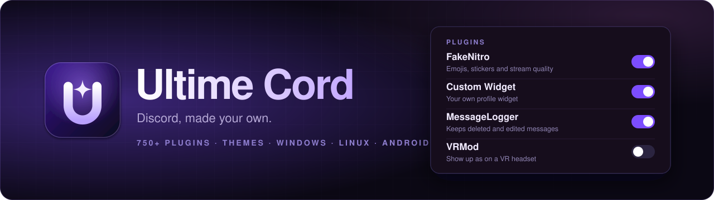
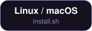
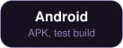
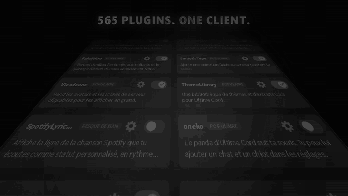
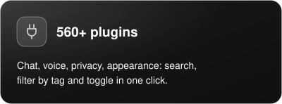
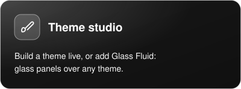
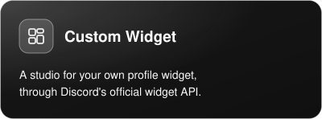
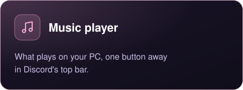
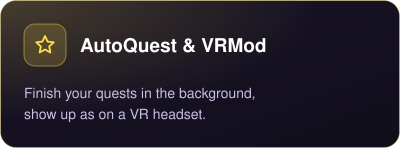
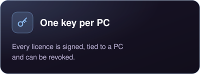

<p align="center">
  <br />
  <strong>Un seul client pour Discord.</strong><br />
  <sub>Ultime Cord se branche sur l'appli officielle (Stable, PTB ou Canary), ajoute ses plugins et son interface, et se retire quand tu veux avec son installeur.</sub>
</p>

<p align="center">
  <a href="https://github.com/lyzral/UltimeCord/releases/latest/download/ultimecord.exe"></a>
  <a href="https://github.com/lyzral/UltimeCord/releases/latest/download/ultimecord-linux.tar.gz"></a>
  <a href="https://github.com/lyzral/UltimeCord/releases/latest/download/ultimecord-android.apk"></a>
  <a href="https://discord.gg/khad"></a>
</p>

<p align="center">
  
</p>

## Ce qu'il y a dedans

<p align="center">
  
  
  
</p>
<p align="center">
  
  
  
</p>

## Installer

**Windows**

1. Télécharge [`ultimecord.exe`](https://github.com/lyzral/UltimeCord/releases/latest/download/ultimecord.exe) et lance-le : il affiche ton **code PC**.
2. Envoie ce code sur le [Discord](https://discord.gg/khad) pour recevoir ta clé.
3. Colle la clé, choisis tes Discord, installe.

**Linux et macOS** — décompresse [`ultimecord-linux.tar.gz`](https://github.com/lyzral/UltimeCord/releases/latest/download/ultimecord-linux.tar.gz), puis :

```sh
sh install.sh --install
```

Le script affiche ton code PC et demande la clé. Il lui faut `python3` et `openssl`.

**Android** — installe l'[APK](https://github.com/lyzral/UltimeCord/releases/latest/download/ultimecord-android.apk). C'est une version de test : le module mobile n'est pas encore publié, l'appli s'installe mais n'a pas encore de module à télécharger.

**iOS** — l'IPA se compile sur un Mac avec Xcode (`mobile/ios`).

## Le dépôt

| Dossier | Contenu |
| --- | --- |
| `desktop/` | Le client PC et navigateur : plugins, thèmes, éditeur CSS et l'installeur `ultimecord.exe`. |
| `mobile/` | Ultime Cord pour Android (installeur et module) et iOS (tweak). |
| `hub/` | Bundles prêts à l'emploi et plugins officiels pour desktop, Android et iOS. |
| `branding/` | Le logo, la vidéo de présentation et les images de cette page, avec les scripts qui les dessinent. |

## Compiler

```sh
# PC (Node 22+ et pnpm)
cd desktop
pnpm install
pnpm build --disable-updater
powershell -ExecutionPolicy Bypass -File scripts/buildInstaller.ps1 -NoSite   # -> ultimecord.exe

# Mobile (bundle)
cd mobile/bundle
bun install
node scripts/build.mjs

# Android (JDK 17 + SDK Android 34)
cd mobile/android/installer
./gradlew assembleDebug
```

## Licence

Ultime Cord est un logiciel libre sous **GPL-3.0-or-later**. Il est construit sur des projets open source, dont Vencord, Equicord et Nightcord : leurs licences et mentions de copyright sont conservées dans les fichiers `LICENSE` et en tête des fichiers source.

<p align="center"><sub>Fait par <a href="https://github.com/lyzral">Sei</a>.</sub></p>
