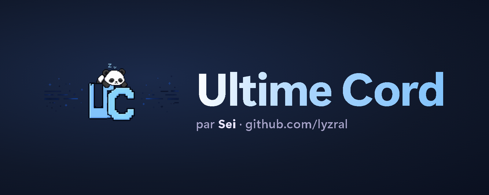

<div align="center">
  
</div>

<div align="center">
  
</div>

<br>

<p align="center">
  Un seul client pour Discord : plus de 500 plugins, un mode audio complet, des thèmes en verre, et une licence par PC.
</p>

<p align="center">
  <a href="https://discord.gg/khad"></a>
  <a href="https://github.com/lyzral/UltimeCord/releases"></a>
</p>

<p align="center">
  
  
  
  
  
  
</p>

---

## `01` — Présentation

Ultime Cord transforme Discord sans le remplacer : il se branche sur l'appli officielle (Stable, PTB ou Canary), ajoute ses plugins et son interface, et peut se retirer à tout moment avec son installeur.

<table align="center">
<tr>
<td width="33%" align="center">

**500+**
<br>
plugins intégrés

</td>
<td width="33%" align="center">

**5**
<br>
plateformes

</td>
<td width="33%" align="center">

**1 clé**
<br>
par PC

</td>
</tr>
</table>

---

## `02` — Ce qu'il y a dedans

<table width="100%">
<tr>
<td width="33%" valign="top">

**`desktop/`**
<br><br>
Le client PC et navigateur : plugins, thèmes, éditeur CSS et l'installeur `ultimecord.exe`.

</td>
<td width="33%" valign="top">

**`mobile/`**
<br><br>
Ultime Cord pour Android (installeur + module) et iOS (tweak), avec les mêmes plugins et thèmes.

</td>
<td width="33%" valign="top">

**`hub/`**
<br><br>
Bundles prêts à l'emploi et plugins officiels pour desktop, Android et iOS.

</td>
</tr>
</table>

---

## `03` — Les plugins Ultime Cord

<table width="100%">
<tr>
<td width="50%" valign="top">

**Glass Fluid**
<br>
Une case dans le Studio de thèmes : verre, fond fluide animé, onglets en pilules et coins arrondis par-dessus n'importe quel thème.

</td>
<td width="50%" valign="top">

**Ultime Script**
<br>
Un décor pixel animé (enfer, paradis…) ou un panneau en verre, avec des outils pour ton propre compte.

</td>
</tr>
<tr>
<td width="50%" valign="top">

**Licences**
<br>
Chaque clé est signée, liée à un PC et révocable. L'installeur et Discord la vérifient à chaque lancement.

</td>
</tr>
</table>

---

## `04` — Installer

<table width="100%">
<tr>
<td width="50%" valign="top">

**Windows**

1. Télécharge `ultimecord.exe` dans les [Releases](https://github.com/lyzral/UltimeCord/releases).
2. Lance-le : il affiche ton **code PC**.
3. Envoie ce code sur le [Discord](https://discord.gg/khad) pour recevoir ta clé.
4. Colle la clé, choisis tes Discord, installe.

</td>
<td width="50%" valign="top">

**Linux / macOS**

```sh
sh install.sh --install
```

Le script affiche ton code PC et demande la clé (il faut `python3` et `openssl`).

**Android** : installe l'APK des Releases.
<br>
**iOS** : l'IPA se compile sur un Mac avec Xcode (`mobile/ios`).

</td>
</tr>
</table>

---

## `05` — Compiler

```sh
# PC (Node 22+ et pnpm)
cd desktop
pnpm install
pnpm build --disable-updater
powershell -ExecutionPolicy Bypass -File scripts/buildInstaller.ps1 -NoSite   # -> ultimecord.exe

# Mobile (bundle)
cd mobile/bundle
bun install
node scripts/build.mjs

# Android (JDK 17 + SDK Android 34)
cd mobile/android/installer
./gradlew assembleDebug
```

---

## `06` — Licence

Ultime Cord est un logiciel libre sous **GPL-3.0-or-later**. Il est construit sur des projets open source : leurs licences et mentions de copyright sont conservées dans les fichiers `LICENSE` et en tête des fichiers source.

<br>

<p align="center">
  <a href="https://discord.gg/khad"></a>
  <a href="https://github.com/lyzral"></a>
</p>

<p align="center"><i>Fait par Sei.</i></p>
